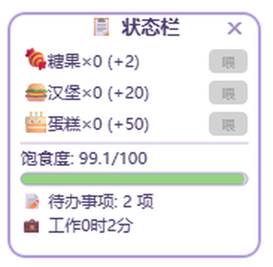

# CuteDesktopPet 🐾 | 萌趣桌面陪伴宠物


**CuteDesktopPet** 是一款基于 Python 与 PyQt6 开发的高颜值桌面虚拟陪伴宠物应用。不仅拥有丰富流畅的动作动画、贴心的定时健康关心与气泡对话，还包含了完整的持续性饱食度系统与工作奖励机制，旨在为你的日常办公、学习与编程提供满满的情绪价值与温暖陪伴！

现在更侧重于轻松的桌面陪伴：单击玩耍、双击摸头，也可以让她在旁边安静地休息。首次出现时坐在屏幕右下方，之后记住你为她选择的位置和大小。

## 日常陪伴

| 操作 | 反应 |
| --- | --- |
| 单击 | 一起蹦蹦跳跳；等待系统双击判定结束后触发 |
| 双击 | 摸摸头，出现爱心和回应。每 5 秒最多加 1 点亲密度，每天最多获得 10 点 |
| 按住拖动 | 按住左键并明显移动后搬家，拖动时保持静态姿势，松手后停下；点击轻微抖动不触发拖动 |
| 滚轮 | 调整大小，范围 80～400 像素 |
| 右键 → 设置 → 安静陪伴 | 停止自主玩耍和主动气泡，保留手动互动 |
| 右键 → 互动 → 睡一会儿 | 原地休息，摸头或选择“叫醒她”可唤醒 |
| 右键 → 互动 → 领取今日零食 | 每个本地自然日可领取汉堡 ×2、糖果 ×3 |
| 右键 → 互动 → 追鼠标 | 两个方向同时追随鼠标，抓到后停下 |
| 右键 → 开启专注模式 | 在 3 秒内切到要专注的窗口，葡萄冻冻会在该屏幕右下角睡觉 |
| 右键 → 设置 → 开机自启动 | 勾选后，登录 Windows 时自动打开桌宠，并使用开机问候 |

在 Windows 上切换到其他窗口约 2 秒后，葡萄冻冻会跑出来敲屏提醒，随后回角落。同一次离开只提醒一次，回到专注窗口后可以再次触发。通过桌宠或托盘菜单结束专注。专注绑定具体窗口，同一窗口内切浏览器标签页不会触发，窗口标题和屏幕内容不会被读取。

平时每隔 25～50 秒，从当前可用的动作中随机挑一个，追鼠标、伸懒腰、闲逛、挥手等动作轮流出现，每轮不会重复。可以在设置里关闭自动追鼠标或自动小睡，选项会保存在存档里。专注模式、安静陪伴和夜间睡衣模式会暂停自主动作。

亲密度十阶门槛为 20、50、100、200、400、600、1000、1500、2000、4000 点。摸头和日常问候的台词会随阶数变得更亲密。工作模式每累计 2 小时增加 1 点，可跨次累计，没有每日或总点数上限。新版首次读取旧存档时，也会结算其中保存的累计工作时长。可以在「设置 → 亲密度说明」查看当前阶数和今日摸头进度。

静止和长睡眠时停用动画、物理定时器；只在活动期间更新动画，并复用已经生成的图像。多屏移动、气泡与面板分别按实际屏幕区域约束。

Windows 混合缩放的双屏或多屏下，追鼠标会沿屏幕共享的边缘穿过，拖动时会保持抓住角色的位置。桌宠继续使用原来的透明窗口，松手后会停在当前屏幕的可用区域内。

<p align="center">
  
</p>

---

## 🌟 核心亮点与特色功能 (Features)

### 1. 🌙 沉浸式夜间关怀与睡衣模式 (Late Night Care)
- **夜间模式触发**：每天晚上 **23:00 至次日 05:00**，宠物会自动换上可爱的睡衣姿态（`pajamas`）。
- **熬夜提示**：伴随温馨气泡提醒：*“太晚啦，不许熬夜，快去睡觉吧~”*。

### 2. 🧘 45分钟久坐伸懒腰健康提醒 (Health Stretch Reminders)
- **久坐防护**：开启工作模式后，每连续工作 **45 分钟**，宠物会自动触发伸懒腰健康提醒：*“站起来活动一下脖子、喝口水吧~”*。
- **昼夜分帧动作**：
  - **夜间 (23:00 后)**：自动切换播放睡衣组分帧伸懒腰动作（`stretch_1` -> `stretch_2` -> `stretch_3`）。
  - **白天 (非深夜)**：自动播放日常服饰组分帧伸懒腰动作（`stretch_4` -> `stretch_5` -> `stretch_6`）。
- **智能镜像继承**：动作方向完全继承前一刻宠物在屏幕上的朝向与水平翻转镜像，确保左右发型、服饰与手臂动作 100% 严丝合缝！

<p align="center">
  
  
  
</p>

### 3. 🍖 零饱食度允许工作与食材奖励系统 (Satiety & Rewards)
- **零饱食度工作**：即使饱食度降为 0 且没有任何食物，也允许启动工作并伴有励志提醒；在工作期间满 15分钟/2小时/5小时依然能稳定赚取糖果、汉堡、蛋糕等食材，用以喂食恢复饱食度。
- **轻松养成**：清醒时每小时消耗 4 点，睡觉和睡衣模式每小时消耗 2 点。离线按睡眠计算，每次离开最多扣除 20 点；亲密度不会因离线下降。
- **工作获得食材**：
  - 🍬 每累计工作 15 分钟获得 **糖果 (+2 饱食度)**
  - 🍔 每累计工作 2 小时获得 **汉堡 (+20 饱食度)**
  - 🎂 每累计工作 5 小时获得 **蛋糕 (+50 饱食度)**
- **休息与恢复**：结束工作后保留食材奖励进度；重新启动会恢复上次未结束的工作，离线时间不计入工作。系统挂起造成超过 60 秒的计时缺口也不计入工作。
- **手控喂食解耦**：工作获得的食材存入仓库，不强制自动吞咽，用户可在状态栏自由选择食物进行喂养！

<p align="center">
  
</p>

### 4. 📝 桌面待办清单与准时完成奖励 (Todo List & Timed Rewards)
- **滑动面板**：`300×280` 面板支持添加待办事项、选择截止日期和时间、勾选完成与删除；跨午夜任务按完整日期计算。
- **准时完成奖励**：在截止分钟结束前勾选完成，系统奖励 **1 颗糖果 (🍬)**。每项待办只能领取一次，取消勾选再完成不会重复奖励。
- **状态栏数智联动**：状态栏新增 **“📝 待办事项: X 项”** 显示未完成项数量，点击该行可直接快捷呼出/收起待办清单。

<p align="center">
  
</p>


### 5. 🍇 自定义“葡萄冻冻”图标与桌面快捷方式 (Icon & Shortcut)
- **快捷方式自动创建**：软件首次运行会在 Windows 桌面自动生成 **“葡萄冻冻.lnk”** 快捷方式。
- **专有图文绑定**：应用程序、托盘与桌面快捷方式均强绑定专有 `葡萄冻冻` 高清图标。

### 6. 📊 交互式状态栏与右键快捷菜单 (Status Panel & Context Menu)
- **极简状态栏**：跟随桌宠的置顶面板，显示饱食度、亲密度、陪伴模式、待办项数、工作时长与食物库存。
- **右键动作快捷菜单**：包含“跳跃”、“跳舞”、“伸懒腰”、“开始/结束工作”、“打开/关闭状态栏”、“打开/关闭待办清单”与“退出”。


---

## 🛠️ 项目目录结构 (Directory Structure)

```text
CuteDesktopPet/
├── assets/                  # 原始素材图像目录
│   └── processed/           # 经过透明化预处理的高质量 PNG 贴图 (idle, run, sleep, pajamas, stretch等)
├── build/                   # PyInstaller 编译临时构建文件
├── dist/                    # 编译打包生成的最终 EXE 可执行程序
│   └── CuteDesktopPet/
│       └── CuteDesktopPet.exe
├── pet.py                   # 主程序逻辑 (PyQt6 界面、动画控制、状态机、持久化)
├── pet_core.py              # 存档校验、迁移、原子保存和行为权重
├── tests/test_pet.py        # 无界面回归验证，使用临时存档
├── process_assets.py        # 资源抠图与去噪预处理脚本 (支持 --force 选项)
├── pet_data.json            # 旧版存档；新版首次运行会尝试迁移
├── CuteDesktopPet.spec      # PyInstaller 打包构建配置文件
└── README.md                # 项目中文说明文档
```

---

## 🚀 快速开始 (Quick Start)

### 1. 依赖安装 (Installation)

确保本地环境为 Python 3.9+，运行以下命令安装所需 PyQt6 与 Pillow 依赖：

```bash
pip install PyQt6 Pillow
```

### 2. 本地运行 (Run)

直接执行主脚本启动桌宠：

```bash
python pet.py
```

### 3. 自定义素材预处理 (Process Custom Assets)

如需加入新的图片资源，可使用内置的图像预处理脚本进行自动透明化背景抠图：

```bash
python process_assets.py
```
*(注：如果需要重新处理已有图像，可以传入 `--force` 参数)*

### 4. 一键重新打包 (Build Executable)

项目内已配置好 `CuteDesktopPet.spec` 文件，使用 PyInstaller 可快速打包为独立的 Windows 免安装 `.exe` 应用：

```bash
python -m PyInstaller CuteDesktopPet.spec --noconfirm
```

打包完成后，可直接运行 `dist/CuteDesktopPet/CuteDesktopPet.exe`！

安装目录只包含运行所需的贴图和图标。打包时将贴图缩至最多 800 像素，原始素材仍保存在仓库中。

发布前可以在 Windows PowerShell 中验证打包产物能加载 Qt 界面和贴图。命令退出码为 `0` 时验证通过。

```powershell
(Start-Process -FilePath .\dist\CuteDesktopPet\CuteDesktopPet.exe -ArgumentList '--smoke-test' -Wait -PassThru).ExitCode
```

## 存档与验证

新版存档位于 Windows 用户数据目录 `%LOCALAPPDATA%\CuteDesktopPet\pet_data.json`。保存通过同目录临时文件原子替换，并保留上一份有效文件 `pet_data.json.bak`。主存档损坏时依次尝试备份和程序旁的旧版存档；旧文件保留不变。位置、大小、亲密度、每日零食领取日期、安静模式和工作奖励进度都会保存。

运行回归验证：

```bash
python -m unittest discover -s tests -v
```

测试使用 Qt 离屏模式和临时目录，不启动桌面快捷方式创建流程，也不读取或改写你的实际存档。

---

## 🤝 贡献与反馈 (Contributing)

欢迎提交 Issue 或 Pull Request 来丰富桌宠的功能！无论是新增动作贴图、有趣的对话气泡，还是新的实用小工具（如番茄钟、白噪音等），都十分欢迎！

---

## 📝 开源许可 (License)

本项目基于 [MIT License](LICENSE) 开源。
