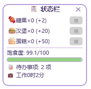
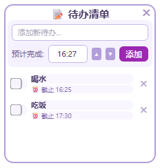

# CuteDesktopPet 🐾 | 萌趣桌面陪伴宠物


**CuteDesktopPet** 是一款基于 Python 与 PyQt6 开发的高颜值桌面虚拟陪伴宠物应用。不仅拥有丰富流畅的动作动画、贴心的定时健康关心与气泡对话，还包含了完整的持续性饱食度系统与工作奖励机制，旨在为你的日常办公、学习与编程提供满满的情绪价值与温暖陪伴！

<p align="center">
  
</p>

---

## 🌟 核心亮点与特色功能 (Features)

### 1. 🌙 沉浸式夜间关怀与睡衣模式 (Late Night Care)
- **夜间模式触发**：每天晚上 **23:00 至次日 05:00**，宠物会自动换上可爱的睡衣姿态（`pajamas`）。
- **熬夜提示**：伴随温馨气泡提醒：*“太晚啦，不许熬夜，快去睡觉吧~”*。

### 2. 🧘 45分钟久坐伸懒腰健康提醒 (Health Stretch Reminders)
- **久坐防护**：开启工作模式后，每连续工作 **45 分钟**，宠物会自动触发伸懒腰健康提醒：*“站起来活动一下脖子、喝口水吧~”*。
- **昼夜分帧动作**：
  - **夜间 (23:00 后)**：自动切换播放睡衣组分帧伸懒腰动作（`stretch_1` -> `stretch_2` -> `stretch_3`）。
  - **白天 (非深夜)**：自动播放日常服饰组分帧伸懒腰动作（`stretch_4` -> `stretch_5` -> `stretch_6`）。
- **智能镜像继承**：动作方向完全继承前一刻宠物在屏幕上的朝向与水平翻转镜像，确保左右发型、服饰与手臂动作 100% 严丝合缝！

<p align="center">
  
  
  
</p>

### 3. 🍖 零饱食度允许工作与食材奖励系统 (Satiety & Rewards)
- **零饱食度工作**：即使饱食度降为 0 且没有任何食物，也允许启动工作并伴有励志提醒；在工作期间满 15分钟/2小时/5小时依然能稳定赚取糖果、汉堡、蛋糕等食材，用以喂食恢复饱食度。
- **离线衰减继承**：饱食度按每 3 分钟 0.5 点自动精确计算扣除，关机后重新打开软件仍能根据离线流逝时间准确衰减，不受中断影响。
- **工作获得食材**：
  - 🍬 连续工作 15 分钟获得 **糖果 (+2 饱食度)**
  - 🍔 连续工作 2 小时获得 **汉堡 (+20 饱食度)**
  - 🎂 连续工作 5 小时获得 **蛋糕 (+50 饱食度)**
- **手控喂食解耦**：工作获得的食材存入仓库，不强制自动吞咽，用户可在状态栏自由选择食物进行喂养！

<p align="center">
  
</p>

### 4. 📝 桌面待办清单与准时完成奖励 (Todo List & Timed Rewards)
- **精致紧凑滑动面板**：经过微调的 `230×240` 黄金精致尺寸，内部包含平滑 `QScrollArea` 上下滑动列表，支持添加待办事项、设置截止时间、勾选完成与删除。
- **准时完成奖励**：在设定截止时间前（或按时）勾选完成，系统会奖励 **1 颗糖果 (🍬)** 并弹窗表扬！
- **状态栏数智联动**：状态栏新增 **“📝 待办事项: X 项”** 显示未完成项数量，点击该行可直接快捷呼出/收起待办清单。

<p align="center">
  
</p>


### 5. 🍇 自定义“葡萄冻冻”图标与桌面快捷方式 (Icon & Shortcut)
- **快捷方式自动创建**：软件首次运行会在 Windows 桌面自动生成 **“葡萄冻冻.lnk”** 快捷方式。
- **专有图文绑定**：应用程序、托盘与桌面快捷方式均强绑定专有 `葡萄冻冻` 高清图标。

### 6. 📊 交互式状态栏与右键快捷菜单 (Status Panel & Context Menu)
- **极简状态栏**：独立拖拽置顶面板，实时显示当前饱食度进度条、待办事项项数、工作时长与食物库存。
- **右键动作快捷菜单**：包含“跳跃”、“跳舞”、“伸懒腰”、“开始/结束工作”、“打开/关闭状态栏”、“打开/关闭待办清单”与“退出”。


---

## 🛠️ 项目目录结构 (Directory Structure)

```text
CuteDesktopPet/
├── assets/                  # 原始素材图像目录
│   └── processed/           # 经过透明化预处理的高质量 PNG 贴图 (idle, run, sleep, pajamas, stretch等)
├── build/                   # PyInstaller 编译临时构建文件
├── dist/                    # 编译打包生成的最终 EXE 可执行程序
│   └── CuteDesktopPet/
│       └── CuteDesktopPet.exe
├── pet.py                   # 主程序逻辑 (PyQt6 界面、动画控制、状态机、持久化)
├── process_assets.py        # 资源抠图与去噪预处理脚本 (支持 --force 选项)
├── pet_data.json            # 持续性存档数据文件 (饱食度、食材数量、上次保存时间)
├── CuteDesktopPet.spec      # PyInstaller 打包构建配置文件
└── README.md                # 项目中文说明文档
```

---

## 🚀 快速开始 (Quick Start)

### 1. 依赖安装 (Installation)

确保本地环境为 Python 3.9+，运行以下命令安装所需 PyQt6 与 Pillow 依赖：

```bash
pip install PyQt6 Pillow
```

### 2. 本地运行 (Run)

直接执行主脚本启动桌宠：

```bash
python pet.py
```

### 3. 自定义素材预处理 (Process Custom Assets)

如需加入新的图片资源，可使用内置的图像预处理脚本进行自动透明化背景抠图：

```bash
python process_assets.py
```
*(注：如果需要重新处理已有图像，可以传入 `--force` 参数)*

### 4. 一键重新打包 (Build Executable)

项目内已配置好 `CuteDesktopPet.spec` 文件，使用 PyInstaller 可快速打包为独立的 Windows 免安装 `.exe` 应用：

```bash
python -m PyInstaller CuteDesktopPet.spec --noconfirm
```

打包完成后，可直接运行 `dist/CuteDesktopPet/CuteDesktopPet.exe`！

---

## 🤝 贡献与反馈 (Contributing)

欢迎提交 Issue 或 Pull Request 来丰富桌宠的功能！无论是新增动作贴图、有趣的对话气泡，还是新的实用小工具（如番茄钟、白噪音等），都十分欢迎！

---

## 📝 开源许可 (License)

本项目基于 [MIT License](LICENSE) 开源。
